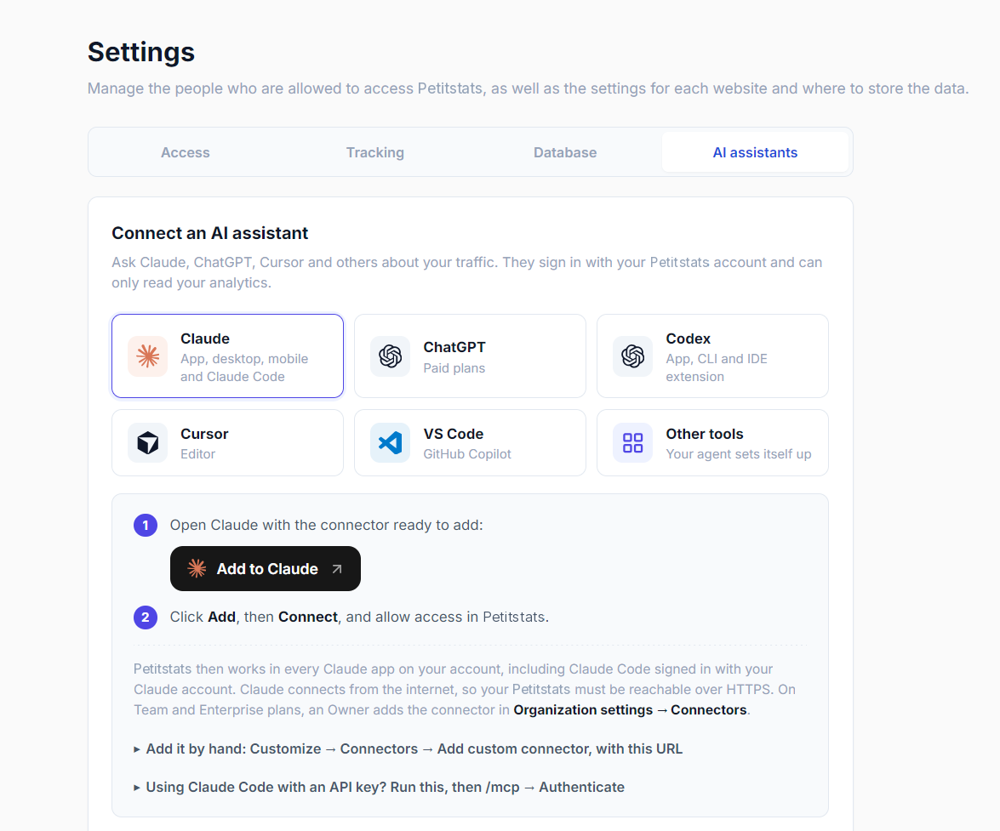

# AI assistants (MCP)

Ask an AI assistant such as Claude or ChatGPT about your traffic, for example "Where did last week's visitors come from?", and it answers from your own Petitstats data. Assistants sign in with your Petitstats account and only read your statistics, unless you let one create and edit your funnels, goals and journeys. They can never delete anything.

## Connect an assistant

Open **Settings → AI assistants** and pick your assistant. Petitstats shows the steps for it, with one-click buttons for Claude, Cursor and VS Code.



When you connect, the assistant opens a Petitstats page in your browser and asks you to allow access. There is no key to copy and nothing else to configure.

The assistant reaches Petitstats from the internet, so your Petitstats must be served over HTTPS. Its address for assistants is your Petitstats address followed by `/mcp.php`, for example `https://analytics.example.com/mcp.php`. The examples below use this one, so replace it with yours.

### Claude

Click **Add to Claude** in **Settings → AI assistants**. Claude opens with the connector already filled in. Click **Add**, then **Connect**, and allow access in Petitstats.

To add it by hand, open **Customize → Connectors → Add custom connector** in Claude, name it **Petitstats** and paste your address. The connector then works in every Claude app on your account, including Claude Code. On Team and Enterprise plans, an owner adds it once in **Organization settings → Connectors**, then each member connects.

If you use Claude Code with an API key rather than a Claude account, run this command, then open `/mcp`, select **petitstats** and choose **Authenticate**.

```bash
claude mcp add --transport http petitstats https://analytics.example.com/mcp.php
```

### ChatGPT

1. In **Settings → Apps → Advanced settings**, turn on **Developer mode**. It needs a paid plan, and on Business or Enterprise plans an admin may have to allow custom apps.
2. Click **Create app**, name it **Petitstats**, choose **OAuth** and paste your address.
3. Click **Create**, then allow access in Petitstats. In a chat, turn the app on from the **+** menu.

### Codex

In Codex, open **Settings → MCP**, add a server named **petitstats** with the **Streamable HTTP** type and your address, then click **Authenticate**. With the Codex command line, run these two commands instead.

```bash
codex mcp add petitstats --url https://analytics.example.com/mcp.php
codex mcp login petitstats
```

### Cursor

Click **Add to Cursor** in **Settings → AI assistants**, then click **Connect** next to petitstats in Cursor's MCP settings and allow access.

### VS Code

Click **Add to VS Code** in **Settings → AI assistants**. When VS Code starts the server, sign in to Petitstats and allow access.

### Other assistants

For Gemini CLI, Windsurf or any other assistant, **Settings → AI assistants → Other tools** gives you a short text to paste into it, and the assistant sets itself up. You can also add your address to the assistant's MCP settings yourself, and most assistants then sign in on their own.

Some versions of Antigravity do not finish signing in. Use an [access token](#access-tokens) with it.

## What assistants can see

Assistants read the same reports as the dashboard, such as visitors, pages, referrers, events, funnels, journeys, countries, devices and blocked bots, for any period. They can also read individual visits, as on the Sessions page: the pages viewed and events triggered, with the country and device. Visits stay anonymous: assistants never see an IP address, and a visitor's code changes every month.

## Charts in the conversation

Assistants that support MCP Apps, such as Claude and ChatGPT, show charts in the conversation instead of raw numbers. Traffic over time appears as on the **Overview** page, and funnels as on the **Funnels** page. Hover over the traffic chart to read the numbers of a day.

Other assistants get the same numbers as text and describe them in their answer.

## Let an assistant edit funnels

An assistant can also create funnels, goals and journeys, or rename them and change their steps, for example "Create a funnel from the pricing page to the signup event". It saves them in the dashboard, where they appear on the **Funnels** page for everyone in your workspace.

Before saving, the assistant shows you a preview with the steps and how many visits reach each one over the period. In assistants that display charts, click **Save funnel** in the preview to save it. Otherwise, tell the assistant to save it.

Each connection only reads until you allow it. In **Settings → AI assistants → Authorized access**, turn on **Can edit funnels** next to the assistant or the access token. Until then, the assistant tells you that it needs this permission. Turn it off to make the connection read-only again. Even when it can edit, an assistant can never delete a funnel, goal or journey, or anything else.

## Manage access

**Settings → AI assistants → Authorized access** lists the connected assistants and your access tokens, with when each was last used. Revoke one to cut its access right away, or turn off **Can edit funnels** to make it read-only again.

After you update Petitstats, an assistant may still use the old list of reports. Refresh it without reconnecting. In Claude, open **Customize → Connectors**, choose Petitstats and click **Update**, then start a new conversation. With other assistants, restart them or reconnect the server.

## Access tokens

Some assistants cannot sign in, for example agents running without a browser. Give them an access token instead. Create one in **Settings → AI assistants → Other tools**, under **Assistant can't sign in?**, and copy it right away, because it is shown only once. Like a sign-in, a token only reads your statistics until you let it [edit funnels](#let-an-assistant-edit-funnels), and you can revoke it at any time.

Add the token to the assistant's MCP settings, as in this example.

```json
{
    "mcpServers": {
        "petitstats": {
            "type": "http",
            "url": "https://analytics.example.com/mcp.php",
            "headers": { "Authorization": "Bearer mlt_your_token" }
        }
    }
}
```

## Troubleshooting

- **The assistant fails with `Unauthorized` without opening a sign-in page.** It cannot sign in on its own. Use an [access token](#access-tokens).
- **No assistant can sign in.** Check that Petitstats is served over HTTPS. On Nginx or Caddy, use the [web server configuration](../operations/README.md#web-server-configuration), which lets assistants sign in. Behind a reverse proxy, the proxy must forward the `X-Forwarded-Proto` header.
